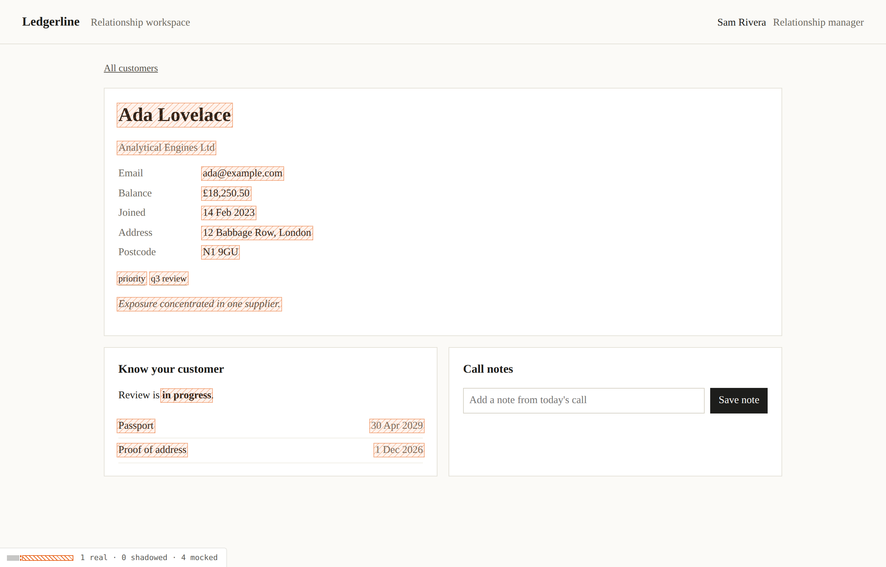
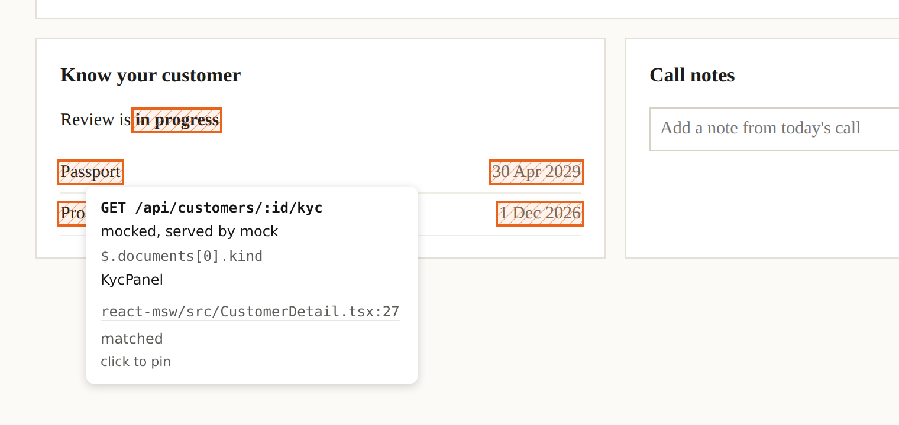
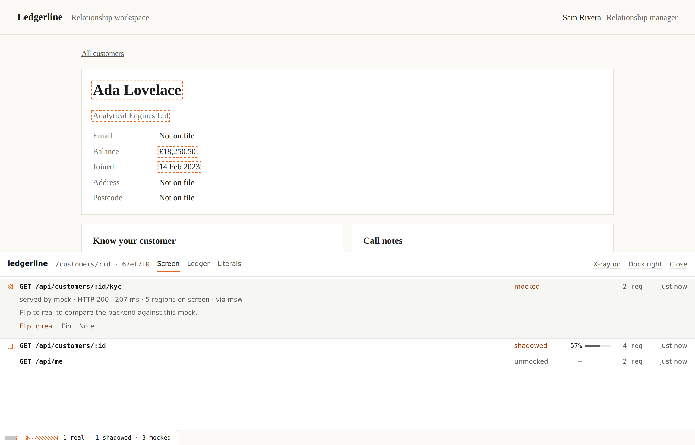
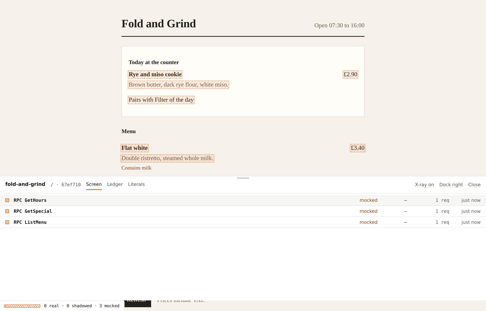

# mockpit

See what is still mock. Watch it become real.

mockpit is a dev-time overlay and migration ledger for apps built mock-first. Point it at your MSW worker (or your Effect Layers) and it inventories every mock, paints the values on screen that came from one, lets you flip a single endpoint to the real backend and compares the two, and keeps a committed ledger so the team can watch the mocks come down.



## Install

```sh
pnpm add -D mockpit
```

```ts
// vite.config.ts
import { mockpit } from "mockpit/vite"

export default { plugins: [mockpit()] }
```

That is the whole integration for a Vite app that uses MSW. The plugin finds any `setupWorker(...)` call in your source and attaches to it, injects the overlay in dev, and writes `.mockpit/ledger.json`. Nothing reaches production builds.

Without the plugin, attach yourself:

```ts
import { setupWorker } from "msw/browser"
import { attach } from "mockpit/msw"

export const worker = setupWorker(...handlers)
attach(worker)
await worker.start()
```

## What you see

**The strip.** A thin bar docked in the bottom-left corner: `9 real · 2 shadowed · 11 mocked`. It is the only permanent UI.

**The x-ray.** Every value on screen that came from a mock is hatched. Values from the real backend while a mock still exists get a dashed outline. Real data gets nothing, so the page gets quieter as the migration proceeds. `Alt+X` toggles it.

**Inspect.** Hold `Alt` and hover any value to see the endpoint, the JSON path, the component and its file and line, and how sure the match is. Click to pin the card, then flip the endpoint from there.



**The drawer.** `Alt+M`, or click the strip. Three views:

- *Screen*: the endpoints this screen uses, their stage, parity and request counts. Hover a row to light up its regions.
- *Ledger*: every endpoint, with a burndown of mock-backed endpoints per commit, regressions marked, and a markdown export.
- *Literals*: hardcoded text from your source that is visible on this screen, with file and line.



Keyboard: `Alt+M` drawer, `Alt+X` x-ray, hold `Alt` to inspect, arrow keys and `Enter` in lists, `F` to flip, `P` to pin, `Escape` to close.

## Stages

An endpoint is the unit of migration: `GET /api/customers/:id`, `RPC ListMenu`, `GRAPHQL GetCustomer`. Its stage is always derived, never set by hand.

| Stage | Means |
| --- | --- |
| mocked | A mock exists and the real backend has never answered it |
| shadowed | A mock exists and the real backend has answered it; parity is measured |
| real | The mock was deleted from source |
| unmocked | The app calls it and no mock was ever written |
| retired | No mock, and not requested for two weeks |

A mock that comes back after its endpoint went real is a regression. The ledger records it, the drawer shows it in red, and `mockpit check` fails on it.

## Flip, shadow, compare

Flip an endpoint to real from the drawer or the inspect card. mockpit adds an override in front of your MSW handler that fetches the real backend, and leaves every other endpoint mocked. While shadowed, each real response is compared with what the mock would have returned (computed with MSW's `getResponse`, no extra request for GET), and the drawer lists missing fields, type changes, nulls and empty arrays.

Per endpoint you can also turn on a safety net, which serves the mock when the real call fails, and leave a one-line note that is committed with the ledger.

Flips are per developer. They live in localStorage and `.mockpit/local.json`, which is gitignored. Stages come from source, so the committed ledger agrees across machines.

## The ledger

`.mockpit/ledger.json` holds, per endpoint, the stage, its history with git SHAs, the screens that use it, the response shapes (paths and types only), parity and the note. It never holds response values. Commit it; the diff in a pull request shows mocks coming down.

```sh
npx mockpit init                         # .mockpit/, .gitattributes, git merge driver
npx mockpit report --base origin/main    # markdown table for a PR
npx mockpit check --base origin/main     # fails on regressions
npx mockpit check --max-mocked 5 --min-parity 0.8
npx mockpit crawl --url http://localhost:5173 --routes /,/customers
npx mockpit promote "GET /api/customers" --handlers src/mocks/handlers.ts --out worker/promoted --remove
```

`promote` moves an MSW resolver into a fetch route you can mount in a Worker, so the endpoint is real infrastructure serving the fixture while the real implementation is written. With `--remove` it deletes the handler and notes the ledger.

### GitHub

```yaml
- uses: actions/checkout@v4
  with: { fetch-depth: 0 }
- run: pnpm install
- uses: deltoidgg/mockpit/.github/actions/ledger-report@main
  with:
    max-mocked: "10"
```

The action posts or updates one comment with the ledger diff against the base branch, writes it to the job summary, and fails on regressions.

## Precision

| Tier | Needs | Gives |
| --- | --- | --- |
| Values | nothing | Text and attributes matched to response values, with scoring and corroboration from neighbours. Marked `inferred` below high confidence. |
| React | `<MockPit />` from `mockpit/react` | Parsed responses are tagged by identity and found in fiber props and hook state. Exact endpoint, path and component. With the plugin, file and line. |
| Effect | `mockpit/effect`, `mockpit/foldkit` | RPC procedures keyed by tag, mock Layers treated as mocks, calls traced through spans to the Foldkit Command that made them, parity against the Schema contract. |

```tsx
// React: once, anywhere in the tree
import { MockPit } from "mockpit/react"
<MockPit />
```

## Effect, Foldkit and the CAFE stack

In an Effect app the mock is usually a Layer, not an HTTP handler, and every procedure shares one `POST /api/rpc`. `mockpit/effect` works at that level:

```ts
import { switchLayer, tracerLayer, fetchLayer } from "mockpit/effect"

// Provide both implementations; mockpit routes each procedure.
export const CafeLive = switchLayer(Cafe, { mock: Memory, real: Rpc }, { group: CafeApi })

// The real Layer's RPC client uses mockpit's fetch, which records each procedure's raw response.
const Rpc = RpcLayer.pipe(Layer.provide(fetchLayer({ rpcPath: "/api/rpc" })))

// Foldkit: provide through resources with the lineage tracer.
Runtime.makeApplication({ ..., resources: Layer.mergeAll(CafeLive, tracerLayer) })
```

- `switchLayer(Tag, { mock, real })` registers the mock's procedures as inventory and lets the drawer flip one procedure at a time.
- `mockLayer` and `realLayer` tag a single Layer when you switch them yourself.
- `contracts(Group)` registers each procedure's success Schema, so parity is measured against the contract even when no mock exists.
- `tracerLayer` records spans. A call made inside a Foldkit Command shows that Command on the inspect card and in the drawer.
- The Vite plugin reads Alchemy v2 state under `.alchemy/state` and shows the stage the real calls reach.



## Without MSW

`start()` from `mockpit` wraps `fetch` and `XMLHttpRequest` in dev, so the ledger still learns what each screen loads. With no inventory every endpoint is `unmocked`. For anything else, `mockpit.record({ key, servedBy, body })`.

## Privacy

Response bodies are read in memory, reduced to a shape and a value index for the current page, and dropped. Only shapes, endpoint keys, route patterns, timestamps, SHAs and notes are written. Bodies over 256 KB, server-sent events and non-JSON responses are never read.

## Limits

- Value matching cannot see text built from short values (`Contains milk` from `["milk"]`) or values transformed beyond common number, date and whitespace formats. The React and Effect tiers narrow this; the inspect card says `inferred` when it is guessing.
- Flipping needs MSW or `switchLayer`. The fetch fallback observes only.
- Stale mock service workers are per browser profile. The strip warns and offers to unregister them; the CLI cannot.

## Examples

- `examples/react-msw`: React 19, MSW 3, and a partly built backend. `pnpm dev`
- `examples/foldkit-cafe`: Foldkit, Effect RPC, a memory Layer, and an Alchemy v2 Worker. `pnpm dev:cafe`

## Development

```sh
corepack pnpm install
pnpm build          # the mockpit package
pnpm typecheck      # package and examples
pnpm test           # unit tests
pnpm test:e2e       # Playwright against both examples
pnpm lint
```

The browser bundle (engine, MSW sensor, projection, overlay, React tier, with Effect and Foldkit) is about 137 KB gzipped through Vite. The overlay is a Foldkit program in a shadow root; the page's DOM and styles are never changed.

## License

MIT
